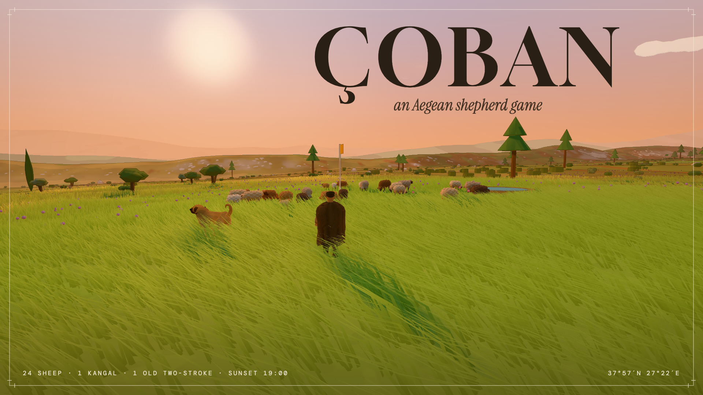
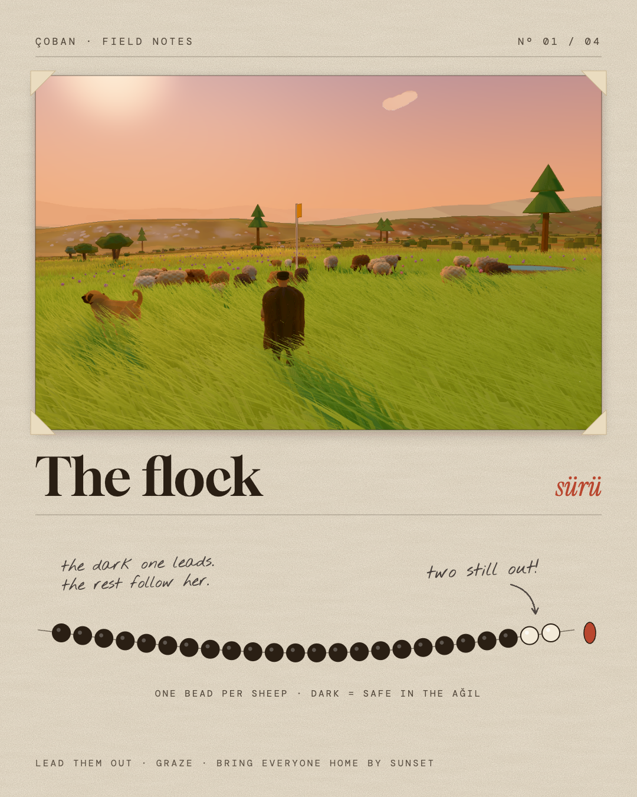
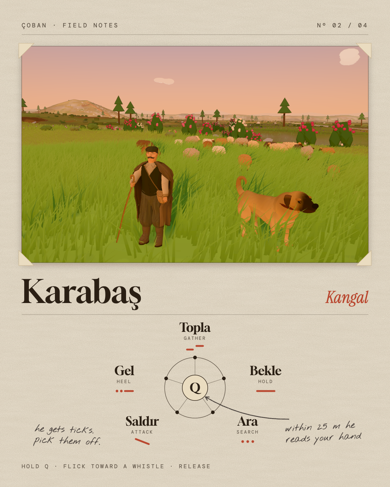
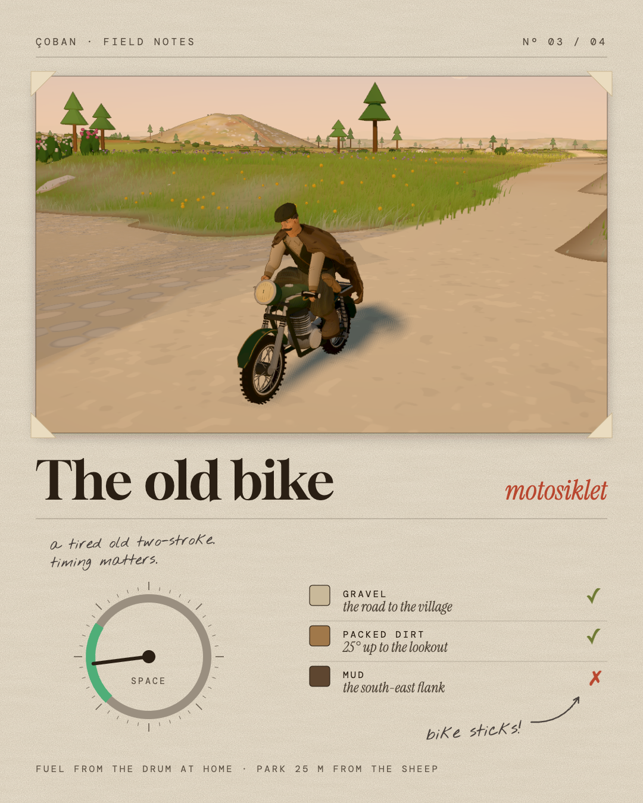
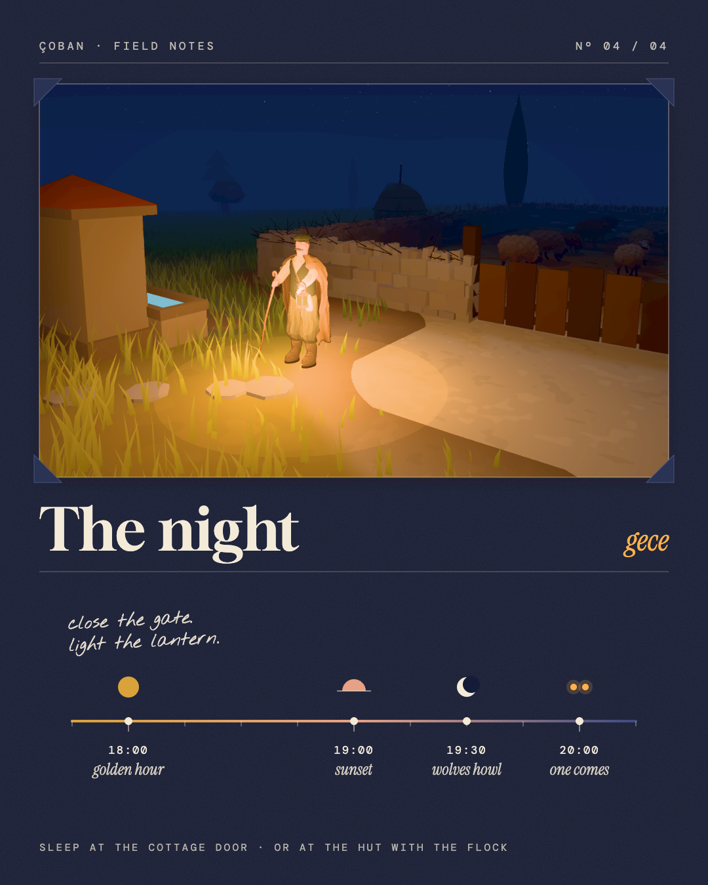

# Çoban: press kit

*An Aegean shepherd game.* A shepherd, twenty-four sheep, a Kangal called Karabaş and an
old two-stroke motorcycle, in a valley of the Aegean hills. Cozy days, scary nights.

Everything here is free to use in articles, videos and posts about the game. All screenshots
are real in-game frames from the current prototype (no paint-overs); the cards and key art
add type and pencil notes around them.

## Key art and logo

| File | Size | Use |
| --- | --- | --- |
| [key-art.png](key-art.png) | 1920×1080 | Article header, video thumbnail |
| [readme-banner.png](readme-banner.png) | 1920×640 | Wide banner (README, store header) |
| [social-preview.png](social-preview.png) | 1280×640 | GitHub social preview, link cards |
| [logo.png](logo.png) | 1024×1024 | Logo on paper |
| [logo-transparent.png](logo-transparent.png) | 1024×1024 | Logo for light backgrounds |

## Field-note cards (1080×1350)

Each card pairs a real frame with the game mechanic behind it.

| | |
| --- | --- |
|  |  |
| **The flock** · the tesbih: one bead per sheep, dark when she is safe in the ağıl | **Karabaş** · the whistle wheel: Topla, Bekle, Ara, Saldır, Gel |
|  |  |
| **The old bike** · kick in the green; gravel and packed dirt yes, mud no | **The night** · golden hour 18:00, sunset 19:00, wolves howl 19:30, one comes at 20:00 |

## Screenshots (1920×1080)

- [Golden hour on the pasture](screenshots/golden-hour-on-the-pasture.png)
- [The shepherd and Karabaş](screenshots/the-shepherd-and-karabas.png)
- [The old bike](screenshots/the-old-bike.png)
- [From the lookout](screenshots/from-the-lookout.png)
- [Night at the ağıl](screenshots/night-at-the-agil.png)
- [Morning at the homestead](screenshots/morning-at-the-homestead.png)

## Fact sheet

- **Setting:** a valley in the Aegean hills near Selçuk, Türkiye
- **You have:** 24 sheep (led by a dark bellwether), Karabaş the Kangal, an old two-stroke
  motorcycle, Uncle Ahmet's pencilled map and notes
- **You do:** lead the flock to good grass and water, work Karabaş with whistles and hand
  signals, ride for supplies, mend Uncle Ahmet's hut, and get everyone home before the wolves
- **Built with:** TypeScript, three.js, Rapier physics, Vite
- **Status:** playable prototype

## Fonts

Gloock, Instrument Serif, DM Mono and Nothing You Could Do, all under the SIL Open Font
License. The visual approach is written up in [DESIGN-PHILOSOPHY.md](DESIGN-PHILOSOPHY.md).
